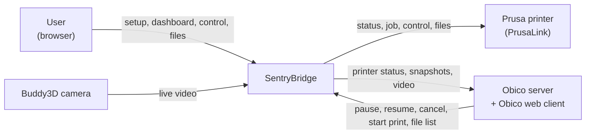
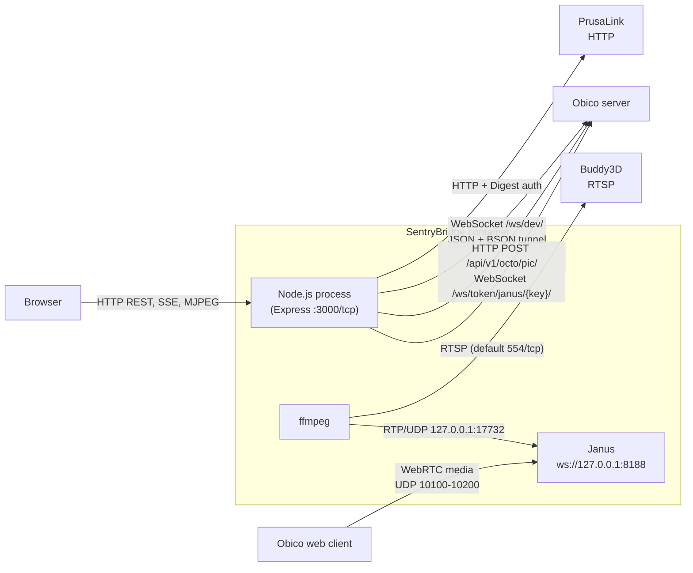

# 3. System Scope and Context

SentryBridge connects one Prusa printer to an Obico server. Neither side is modified: towards the printer it is a PrusaLink and RTSP client, towards Obico it is an agent that identifies itself as `moonraker_obico` (`src/obico/agent.ts`) and uses Obico's agent endpoints (`/ws/dev/`, `/api/v1/octo/*`).

## Business Context

| Partner                           | Input to SentryBridge                                                             | Output from SentryBridge                                                        | Source                                                            |
| --------------------------------- | --------------------------------------------------------------------------------- | ------------------------------------------------------------------------------- | ----------------------------------------------------------------- |
| User (browser)                    | Setup data (wizard), control commands, file uploads, reconnect requests           | Web UI, live status, MJPEG stream, health and boot-check reports                | `src/server.ts`, `src/routes/*.ts`                                |
| Prusa printer (PrusaLink)         | Printer status, active job, printer info, file list and sizes                     | Pause, resume, cancel, upload, start print, delete file                         | `src/prusalink/client.ts`, `src/prusalink/types.ts`               |
| Buddy3D camera                    | RTSP video stream                                                                 | —                                                                               | `src/camera/camera.ts`                                            |
| Obico server and Obico web client | Pairing confirmation, control commands, tunnelled HTTP requests, WebRTC signaling | Status messages, JPEG snapshots, agent identity, tunnel responses, WebRTC video | `src/obico/agent.ts`, `src/obico/tunnel.ts`, `src/janus/relay.ts` |

## Technical Context

| Channel               | Protocol / port                                                                          | Direction (initiator)                  | Details                                                                                                                                                                         | Source                                                         |
| --------------------- | ---------------------------------------------------------------------------------------- | -------------------------------------- | ------------------------------------------------------------------------------------------------------------------------------------------------------------------------------- | -------------------------------------------------------------- |
| PrusaLink API         | HTTP with Digest authentication (`digest-fetch`)                                         | SentryBridge → printer                 | `GET /api/v1/status`, `/api/v1/job`, `/api/v1/info`; `PUT /api/v1/job/{id}/pause\|resume`; `DELETE /api/v1/job/{id}`; `/api/v1/files/usb/…` (list, size, upload, start, delete) | `src/prusalink/client.ts`                                      |
| Camera stream         | RTSP or RTSPS (URL from config, e.g. `rtsp://[printer-ip]/live`; RTSP default port 554)  | SentryBridge (ffmpeg) → camera         | One ffmpeg process decodes to JPEG frames (`image2pipe`), a second one sends H.264 as RTP                                                                                       | `src/camera/camera.ts`, `src/config/rtsp.ts`                   |
| Obico agent WebSocket | WebSocket `{server}/ws/dev/`, JSON text frames and BSON binary frames                    | SentryBridge → Obico                   | Status messages, commands (`target/func/args`), `http.tunnelv2` requests answered with BSON (zlib-compressed content), Janus signaling (`{"janus": …}`)                         | `src/obico/agent.ts`, `src/obico/tunnel.ts`                    |
| Obico REST            | HTTP(S)                                                                                  | SentryBridge → Obico                   | `POST /api/v1/octo/pic/` (JPEG snapshots), `/api/v1/octo/verify/` (pairing), `/api/v1/octo/printer/` (printer id, agent name `moonraker_obico` and version)                     | `src/obico/agent.ts`                                           |
| Janus relay           | WebSocket `{server}/ws/token/janus/{apiKey}/` ↔ `ws://127.0.0.1:8188` (`janus-protocol`) | SentryBridge → Obico and → local Janus | Forwards Janus signaling between Obico and the local Janus gateway                                                                                                              | `src/janus/relay.ts`, `src/janus/manager.ts`                   |
| RTP feed              | RTP over UDP, `127.0.0.1:17732`                                                          | ffmpeg → Janus (inside the container)  | H.264 video for the Janus streaming mount                                                                                                                                       | `src/bridge.ts` (`JANUS_RTP_PORT`), `src/camera/camera.ts`     |
| WebRTC media          | UDP, `JANUS_RTP_PORT_RANGE` (default `10100-10200`), ICE address from `JANUS_HOST_IP`    | Obico web client ↔ Janus               | Janus advertises the host IP via `nat_1_1_mapping`                                                                                                                              | `src/janus/jcfg.ts`, `Dockerfile`, `docker-compose.yml`        |
| Web UI and API        | HTTP on `PORT` (default `3000`)                                                          | Browser → SentryBridge                 | React SPA under `/`, REST under `/api/`, MJPEG under `/stream`; all requests pass the Host/Origin guard                                                                         | `src/server.ts`, `src/lib/request-guard.ts`, `src/routes/*.ts` |
| Live status           | Server-Sent Events, `GET /api/status/stream`                                             | Browser → SentryBridge (server pushes) | Status updates and file-size progress for the dashboard                                                                                                                         | `src/routes/dashboard.ts`                                      |
