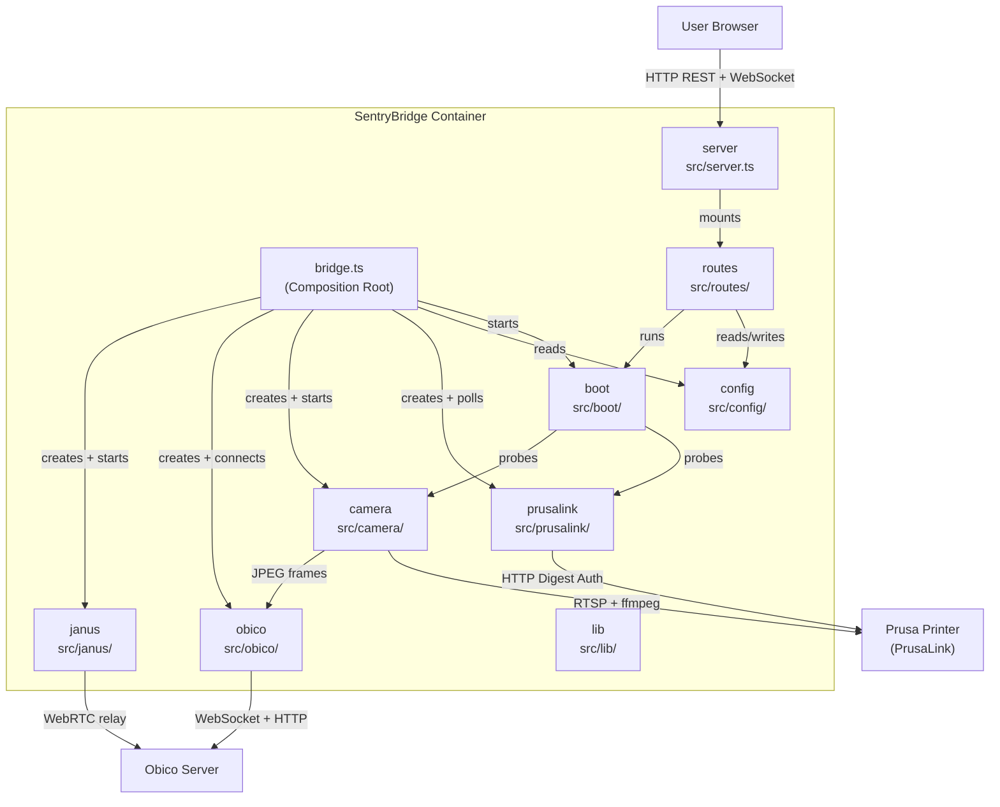

# 5. Building Block View

## Level 1 — System Decomposition

SentryBridge is decomposed into four core modules plus supporting components (janus, boot, lib, routes, server). The `bridge` module is the composition root that wires them all together.

## Module Responsibilities

### config (`src/config/`)

Reads and writes the JSON configuration file from the Docker volume (`/config/config.json`). Exposes `loadConfig()`, `saveConfig()`, `isConfigured()`, and a `configEmitter` that fires `config-changed` events when the config is saved. The bridge subscribes to this event to apply hot-reload. `secrets.ts` builds the public config (secrets replaced by set/not-set hints, RTSP userinfo redacted) and fills empty incoming secrets from the stored config only for the same target (`mergeStoredSecrets`, ADR-0014). `rtsp.ts` accepts only `rtsp://` / `rtsps://` camera URLs before they reach ffmpeg and redacts their userinfo.

### prusalink (`src/prusalink/`)

HTTP Digest Auth client for the PrusaLink API. Created per config; all requests go through a single `request()` helper that is covered by the circuit breaker. Responsibilities: poll printer status and active job, relay pause/resume/cancel commands, provide file management (list, upload, start print, delete). `file-size-cache.ts` looks up file sizes in the background, one file at a time, and persists them in `file-sizes.json` next to the config (ADR-0015). `octoprint.ts` maps PrusaLink files to the OctoPrint file shape that Obico's file dialog expects.

### camera (`src/camera/`)

Runs a persistent ffmpeg subprocess that reads the RTSP stream and emits JPEG frames (MJPEG, 5 fps) to subscribers registered via `onFrame(cb)` or `subscribe()`; the bridge throttles uploads to the configured frame interval. A second ffmpeg process produces the RTP stream used by the Janus relay. Both have watchdogs and restart on failure; the MJPEG process is guarded by the `camera` circuit breaker. Handles graceful shutdown (`stopGracefully(timeoutMs)`). `registry.ts` holds the running camera instance so the stream route and boot checks reuse it instead of opening a second RTSP session.

### obico (`src/obico/`)

WebSocket client that connects to `wss://{server}/ws/dev/` with a Bearer token. Uses Obico's OctoPrint-compatible endpoints and reports itself as `moonraker_obico` 2.1.0 (ADR-0002): pairing flow, periodic status messages, JPEG frame upload (own `obico_frames` circuit breaker), command dispatch (pause/resume/cancel/start). Maintains an `activePrintFileId` closure state that survives reconnects. `tunnel.ts` answers `http.tunnelv2` requests (BSON frames, zlib-compressed content) for the allowed `/api/*` paths (ADR-0010). `print-start-store.ts` persists the current PrusaLink job id and its start timestamp in `print-state.json`, so a restart during a print keeps one print in Obico (ADR-0015).

### janus (`src/janus/`)

Two sub-components:

- **janusManager**: lifecycle management for the bundled Janus WebRTC gateway process
- **janusRelay**: bridges the camera RTP stream into a Janus video room and signals the Obico server

### bridge (`src/bridge.ts`, `src/bridge/state.ts`)

Composition root. Creates all modules, wires frame forwarding (`camera.onFrame → agent.sendFrame`), starts the polling interval (`setInterval → pollAndSend`), subscribes to config changes, starts the boot checks, and implements `reconnectComponent()` for manual recovery from the dashboard. `bridge/state.ts` holds the shared bridge state (`activePrintFileId`).

### boot (`src/boot/`)

Non-blocking startup diagnostics (ADR-0016). `checks.ts` runs five checks (PrusaLink reachable, PrusaLink credentials, camera RTSP, Obico reachable, Obico paired) and returns i18n hint keys, never error text; a failed camera check is retried once after 15 s. `service.ts` wires the live probes (reusing the running camera's latest frame when available), stores the latest report and lets concurrent callers share one run.

### lib (`src/lib/`)

Cross-cutting helpers: `circuit-breaker.ts` and the breaker registry in `health.ts`, `health-monitor.ts` (per-component health state and error log), `retry.ts` (exponential backoff), `env-config.ts` (environment variables with defaults), `request-guard.ts` (Host/Origin guard, ADR-0013), and `terminate.ts` (SIGTERM, then SIGKILL after 5 s for child processes).

### routes (`src/routes/`)

Express routers: `wizard.ts` (`/api/wizard/*`, setup wizard tests and pairing), `dashboard.ts` (`/api/config`, `/api/status/stream`, `/api/printer/info`, `/api/camera/snapshot`, `/api/control`, `/api/setup/save`), `bridge.ts` (`/api/bridge/reconnect`), `files.ts` (`/api/files`, PrusaLink file proxy), `health.ts` (`/api/health/*`), `boot-checks.ts` (`GET`/`POST /api/boot-checks`) and `stream.ts` (MJPEG stream at `/stream`). `setup.ts` holds the shared validation and save logic for the setup payload.

### server (`src/server.ts`)

Express application. Mounts the request guard (`src/lib/request-guard.ts`) before everything else, serves the compiled React SPA as static files under `/`, and mounts the route modules under `/api/` (the MJPEG stream at `/stream`). Starts `startBridge()` on boot if the system is configured.
