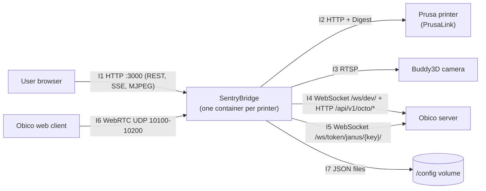
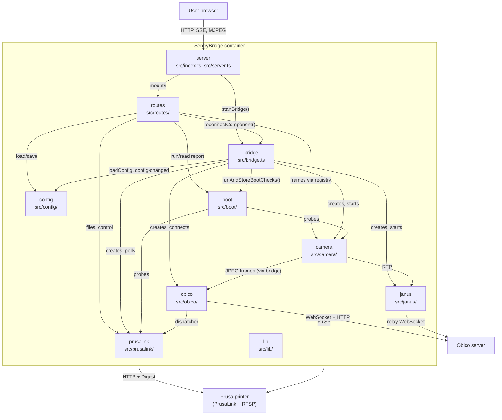
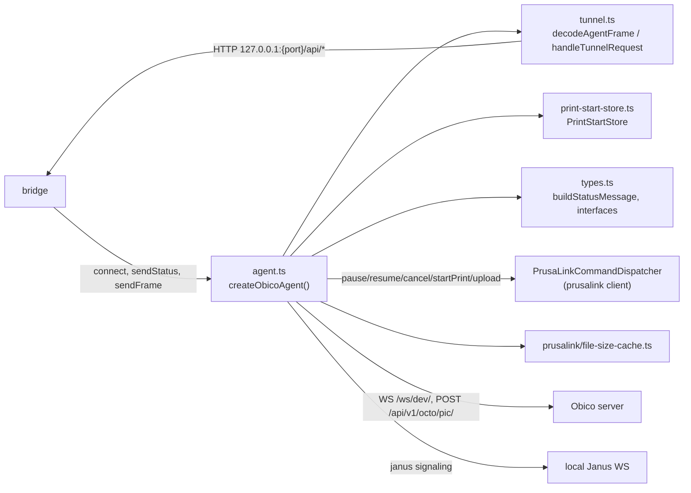
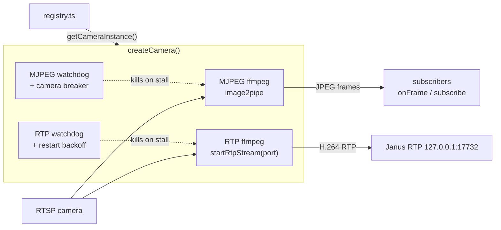
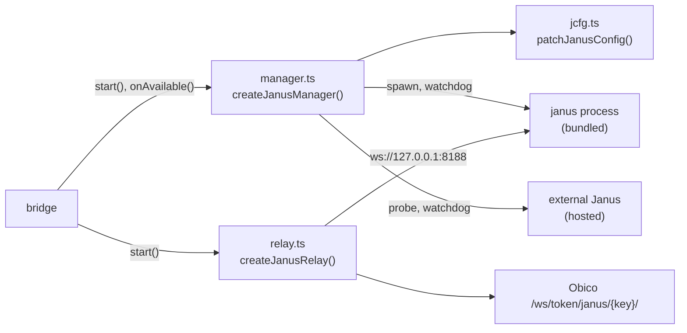
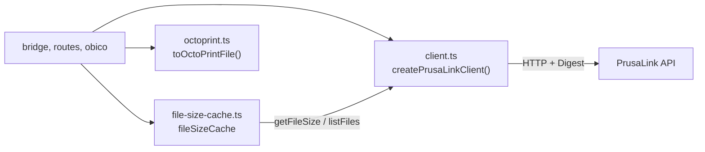
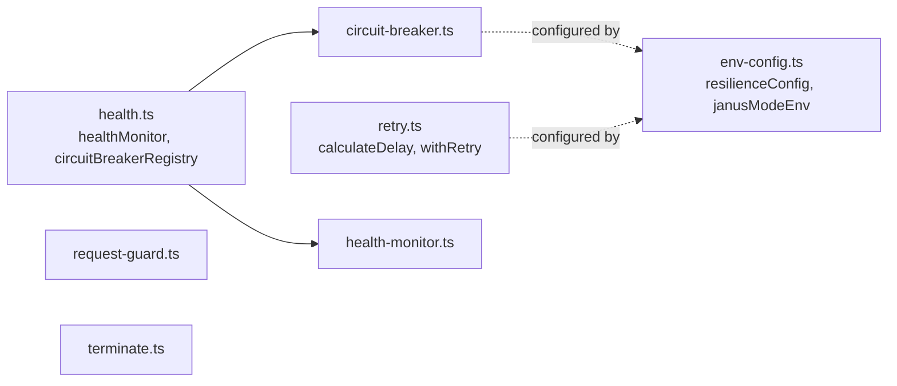

# 5. Building Block View

## Level 0 — SentryBridge as a Black Box

| ID  | Interface             | Provided / required | Description                                                                                            | Source                                                                                       |
| --- | --------------------- | ------------------- | ------------------------------------------------------------------------------------------------------ | -------------------------------------------------------------------------------------------- |
| I1  | Web UI and REST API   | provided            | SPA under `/`, `/api/*` routes, SSE `/api/status/stream`, MJPEG `/stream`, behind the request guard    | `src/server.ts`, `src/routes/*.ts`, `src/lib/request-guard.ts`                               |
| I2  | PrusaLink API         | required            | Status, job, info, job control, USB file management                                                    | `src/prusalink/client.ts`                                                                    |
| I3  | RTSP camera stream    | required            | Read by two ffmpeg processes (MJPEG frames, H.264 RTP)                                                 | `src/camera/camera.ts`                                                                       |
| I4  | Obico agent interface | required            | Agent WebSocket (status, commands, BSON tunnel, Janus signaling), snapshot upload, pairing, agent info | `src/obico/agent.ts`, `src/obico/tunnel.ts`                                                  |
| I5  | Obico Janus relay     | required            | Janus signaling between Obico and the local Janus                                                      | `src/janus/relay.ts`                                                                         |
| I6  | WebRTC media          | provided            | Janus media ports (`JANUS_RTP_PORT_RANGE`, ICE address `JANUS_HOST_IP`)                                | `src/janus/jcfg.ts`, `src/janus/manager.ts`                                                  |
| I7  | Configuration volume  | required            | `config.json`, `print-state.json`, `file-sizes.json`                                                   | `src/config/config.ts`, `src/obico/print-start-store.ts`, `src/prusalink/file-size-cache.ts` |

## Level 1 — Whitebox SentryBridge

`lib` is used by almost every block (breakers, retry, health monitor) and has no outgoing dependencies; those edges are omitted.

### server

| Aspect   | Content                                                                                                                                                                                                          |
| -------- | ---------------------------------------------------------------------------------------------------------------------------------------------------------------------------------------------------------------- |
| Purpose  | Express application: request guard first, static SPA under `/`, routers under `/api/`, MJPEG router at `/stream`; `index.ts` listens on `PORT`, starts the bridge when configured and stops it on SIGTERM/SIGINT |
| Provides | I1 (`app`)                                                                                                                                                                                                       |
| Requires | routes, bridge, config, lib (`requestGuard`)                                                                                                                                                                     |
| Source   | `src/server.ts`, `src/index.ts`                                                                                                                                                                                  |

### routes

| Aspect   | Content                                                                                                                                                                                                                                                                                                                                                                                                                     |
| -------- | --------------------------------------------------------------------------------------------------------------------------------------------------------------------------------------------------------------------------------------------------------------------------------------------------------------------------------------------------------------------------------------------------------------------------- |
| Purpose  | HTTP endpoints: `wizard.ts` (`/api/wizard/*`), `dashboard.ts` (`/api/config`, SSE `/api/status/stream`, `/api/printer/info`, `/api/camera/snapshot`, `/api/control`, `/api/setup/save`), `bridge.ts` (`/api/bridge/reconnect`), `files.ts` (`/api/files`), `health.ts` (`/api/health`, `/live`, `/ready`), `boot-checks.ts` (`/api/boot-checks`), `stream.ts` (`/stream`); `setup.ts` validates and saves the setup payload |
| Provides | Express routers                                                                                                                                                                                                                                                                                                                                                                                                             |
| Requires | config, boot, prusalink, camera (`getCameraInstance`), bridge, lib (`healthMonitor`)                                                                                                                                                                                                                                                                                                                                        |
| Source   | `src/routes/*.ts`                                                                                                                                                                                                                                                                                                                                                                                                           |

### bridge

| Aspect   | Content                                                                                                                                                                                                      |
| -------- | ------------------------------------------------------------------------------------------------------------------------------------------------------------------------------------------------------------ |
| Purpose  | Composition root: creates all modules, wires frame forwarding (`registerFrameForwarding`), polls PrusaLink and sends status, hot-reloads on config changes (`diffConfig`), manual recovery, ordered shutdown |
| Provides | `startBridge()`, `stopBridge()`, `reconnectComponent()`, `JANUS_RTP_PORT`                                                                                                                                    |
| Requires | config, prusalink, camera, obico, janus, boot, lib                                                                                                                                                           |
| Source   | `src/bridge.ts`, `src/bridge/state.ts`                                                                                                                                                                       |

### config

| Aspect   | Content                                                                                                                                                                                    |
| -------- | ------------------------------------------------------------------------------------------------------------------------------------------------------------------------------------------ |
| Purpose  | Reads and writes `config.json`, emits `config-changed`; builds the public config without secrets and merges stored secrets for the same target (ADR-0014); validates and redacts RTSP URLs |
| Provides | `loadConfig()`, `saveConfig()`, `isConfigured()`, `tryLoadConfig()`, `configEmitter`, `toPublicConfig()`, `mergeStoredSecrets()`, `assertRtspUrl()`, `redactRtspUrl()`                     |
| Requires | I7                                                                                                                                                                                         |
| Source   | `src/config/config.ts`, `src/config/secrets.ts`, `src/config/rtsp.ts`                                                                                                                      |

### boot

| Aspect   | Content                                                                                                                                        |
| -------- | ---------------------------------------------------------------------------------------------------------------------------------------------- |
| Purpose  | Non-blocking startup diagnostics (ADR-0016): five checks returning i18n hint keys; camera check retried once; concurrent callers share one run |
| Provides | `runBootChecks()`, `runAndStoreBootChecks()`, `getBootCheckReport()`                                                                           |
| Requires | prusalink, camera (`getCameraInstance`), obico reachability                                                                                    |
| Source   | `src/boot/checks.ts`, `src/boot/service.ts`                                                                                                    |

### prusalink

| Aspect   | Content                                                                                                      |
| -------- | ------------------------------------------------------------------------------------------------------------ |
| Purpose  | PrusaLink client with Digest auth, circuit breaker and retry; file size cache; OctoPrint file mapping        |
| Provides | `PrusaLinkClient` (also used as `PrusaLinkCommandDispatcher` by obico), `fileSizeCache`, `toOctoPrintFile()` |
| Requires | I2, lib, I7 (`file-sizes.json`)                                                                              |
| Source   | `src/prusalink/*.ts`                                                                                         |

### camera

| Aspect   | Content                                                                                                        |
| -------- | -------------------------------------------------------------------------------------------------------------- |
| Purpose  | ffmpeg-based MJPEG frame source and H.264 RTP sender, each with watchdog and restart; shared instance registry |
| Provides | `CameraModule`, `setCameraInstance()`, `getCameraInstance()`                                                   |
| Requires | I3, lib                                                                                                        |
| Source   | `src/camera/*.ts`                                                                                              |

### obico

| Aspect   | Content                                                                                                                                                                    |
| -------- | -------------------------------------------------------------------------------------------------------------------------------------------------------------------------- |
| Purpose  | Obico agent (`moonraker_obico`, ADR-0002): pairing, status, snapshot upload, command dispatch, HTTP tunnel (ADR-0010), Janus signaling, print start persistence (ADR-0015) |
| Provides | `ObicoAgent`                                                                                                                                                               |
| Requires | I4, `PrusaLinkCommandDispatcher`, prusalink (`fileSizeCache`, `toOctoPrintFile`), lib, I7 (`print-state.json`)                                                             |
| Source   | `src/obico/*.ts`                                                                                                                                                           |

### janus

| Aspect   | Content                                                                         |
| -------- | ------------------------------------------------------------------------------- |
| Purpose  | Lifecycle of a bundled or hosted Janus gateway and the signaling relay to Obico |
| Provides | `JanusManager`, `JanusRelay`, I6                                                |
| Requires | I5, local Janus WebSocket `ws://127.0.0.1:8188`, lib                            |
| Source   | `src/janus/*.ts`                                                                |

### lib

| Aspect   | Content                                                                                                                     |
| -------- | --------------------------------------------------------------------------------------------------------------------------- |
| Purpose  | Cross-cutting helpers: health monitor, circuit breaker, retry/backoff, env config, request guard, child-process termination |
| Provides | see Level 2                                                                                                                 |
| Requires | environment variables                                                                                                       |
| Source   | `src/lib/*.ts`                                                                                                              |

## Level 2

### obico

| Element            | Responsibility                                                                                                                                                   | Source                           |
| ------------------ | ---------------------------------------------------------------------------------------------------------------------------------------------------------------- | -------------------------------- |
| `createObicoAgent` | WebSocket with reconnect backoff and `obico_ws` breaker; frame upload with `obico_frames` breaker; pairing; agent info PATCH; command and Janus message handling | `src/obico/agent.ts`             |
| tunnel             | Decodes JSON/BSON frames, allows only canonical `/api/*` paths, encodes BSON responses with zlib-compressed content                                              | `src/obico/tunnel.ts`            |
| `PrintStartStore`  | Memory and file (`print-state.json`) store of the current job id and start time                                                                                  | `src/obico/print-start-store.ts` |
| types              | `ObicoAgent`, `PrusaLinkCommandDispatcher`, `buildStatusMessage()`, `isIdleState()`                                                                              | `src/obico/types.ts`             |

### camera

| Element    | Responsibility                                                                                                                             | Source                   |
| ---------- | ------------------------------------------------------------------------------------------------------------------------------------------ | ------------------------ |
| MJPEG path | `start()`, `stop()`, `stopGracefully()`, `onFrame()`, `subscribe()`, `latestFrame()`; watchdog on missing frames, `camera` circuit breaker | `src/camera/camera.ts`   |
| RTP path   | `startRtpStream()`, `stopRtpStream()`; watchdog and restart with `calculateDelay` backoff                                                  | `src/camera/camera.ts`   |
| registry   | Holds the running instance so `/stream`, snapshots and boot checks reuse it                                                                | `src/camera/registry.ts` |
| types      | `CameraConfig`, `CameraModule`, `FrameSubscriber`                                                                                          | `src/camera/types.ts`    |

### janus

| Element              | Responsibility                                                                                                                            | Source                 |
| -------------------- | ----------------------------------------------------------------------------------------------------------------------------------------- | ---------------------- |
| `createJanusManager` | Chooses mode (`JANUS_MODE`: bundled, hosted, auto → `hosted`/`bundled`/`unavailable`), spawns or probes Janus, watchdogs, `onAvailable()` | `src/janus/manager.ts` |
| `patchJanusConfig`   | Applies `JANUS_HOST_IP` (`nat_1_1_mapping`) and `JANUS_RTP_PORT_RANGE` (`rtp_port_range`) to the Janus config                             | `src/janus/jcfg.ts`    |
| `createJanusRelay`   | Bidirectional WebSocket relay local Janus ↔ Obico with reconnect backoff                                                                  | `src/janus/relay.ts`   |

### prusalink

| Element                 | Responsibility                                                                                                            | Source                             |
| ----------------------- | ------------------------------------------------------------------------------------------------------------------------- | ---------------------------------- |
| `createPrusaLinkClient` | `PrusaLinkClient` methods via one request helper with `prusalink` breaker and `withRetry`; serves as the obico dispatcher | `src/prusalink/client.ts`          |
| `fileSizeCache`         | Sequential background size lookup, persisted in `file-sizes.json` (ADR-0015); size and progress events                    | `src/prusalink/file-size-cache.ts` |
| `toOctoPrintFile`       | Maps `FileEntry` to the OctoPrint file shape expected by Obico                                                            | `src/prusalink/octoprint.ts`       |
| types                   | `PrusaLinkClient`, `PrinterStatus`, `JobInfo`, `FileEntry`, …                                                             | `src/prusalink/types.ts`           |

### lib

| Element         | Responsibility                                                                            | Source                       |
| --------------- | ----------------------------------------------------------------------------------------- | ---------------------------- |
| health monitor  | Per-component health state and error log, critical detection (`camera`), `markReported()` | `src/lib/health-monitor.ts`  |
| health registry | Singleton `healthMonitor`, `circuitBreakerRegistry`, current `janusMode`                  | `src/lib/health.ts`          |
| circuit breaker | `createCircuitBreaker()` with CLOSED/OPEN/HALF_OPEN states                                | `src/lib/circuit-breaker.ts` |
| retry           | Deterministic exponential backoff (`calculateDelay`) and `withRetry()`                    | `src/lib/retry.ts`           |
| env config      | `resilienceConfig`, `janusDebugLevel`, `janusModeEnv` from environment variables          | `src/lib/env-config.ts`      |
| request guard   | Host/Origin check middleware (ADR-0013)                                                   | `src/lib/request-guard.ts`   |
| terminate       | SIGTERM, then SIGKILL after a timeout, for ffmpeg and Janus child processes               | `src/lib/terminate.ts`       |
