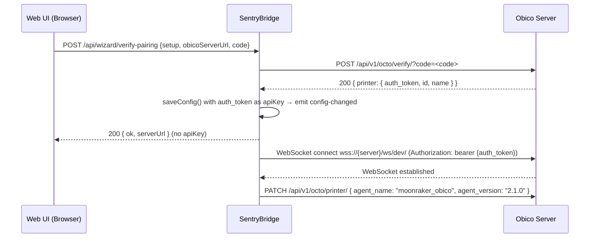
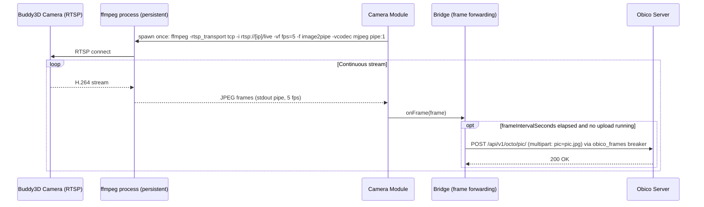
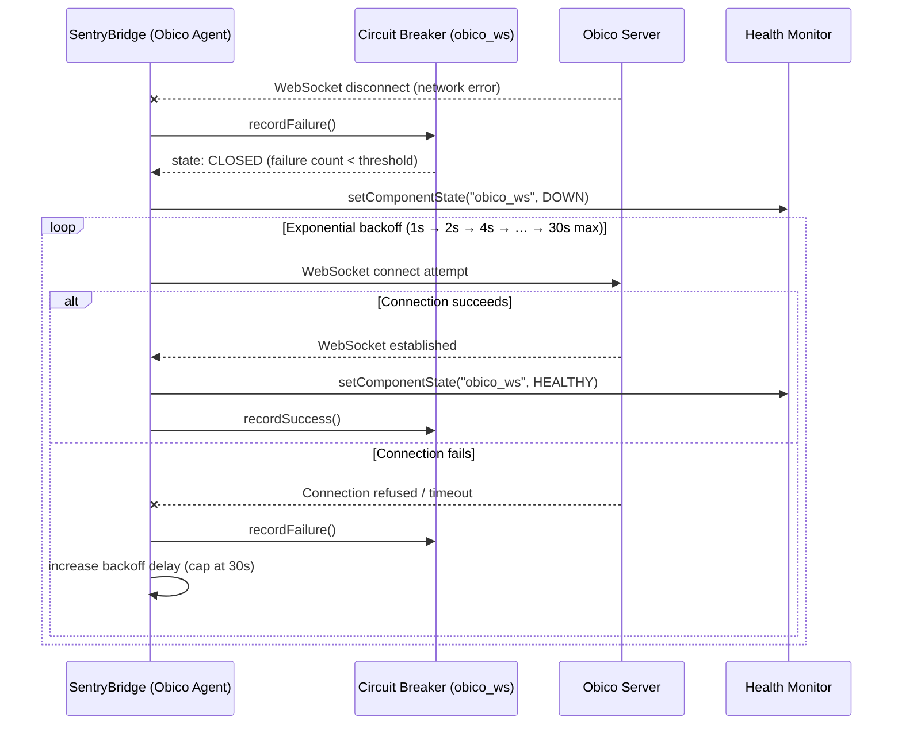
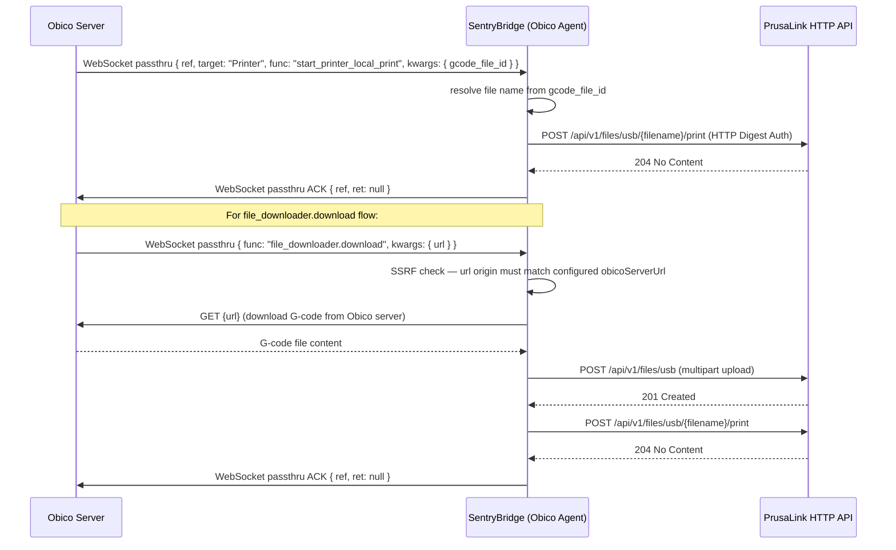
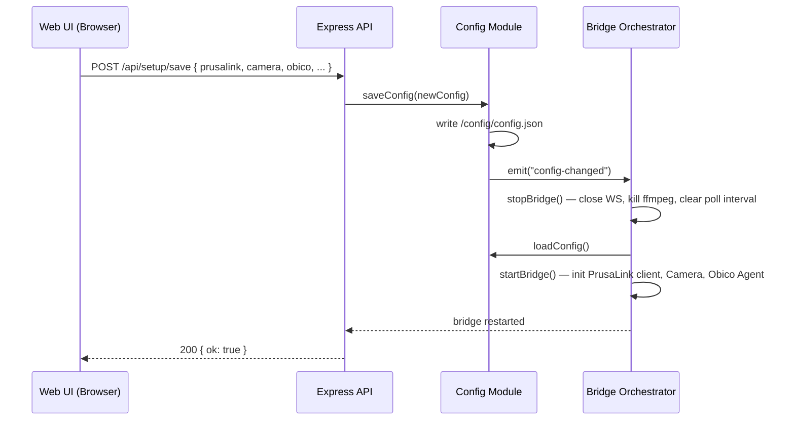
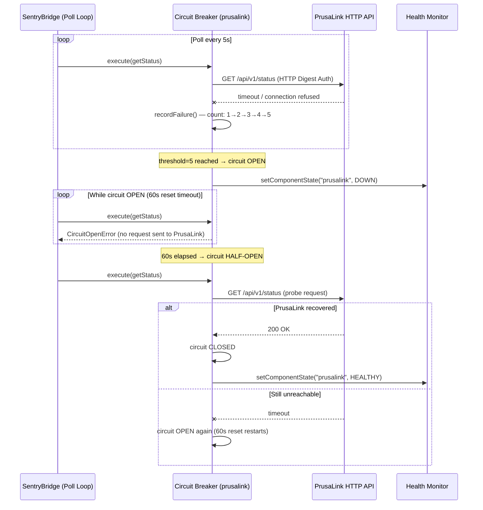
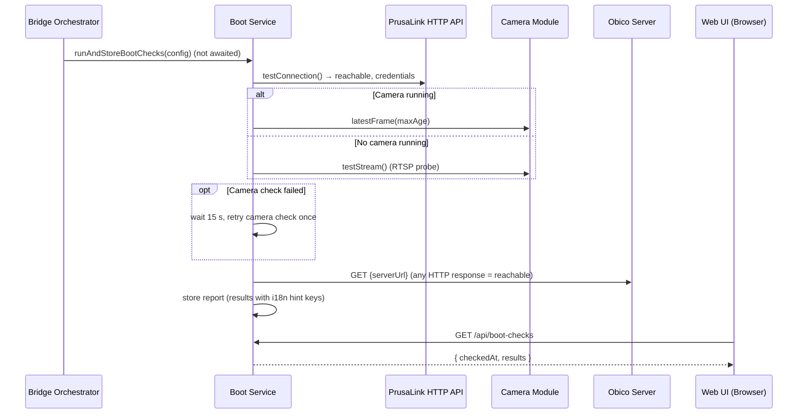
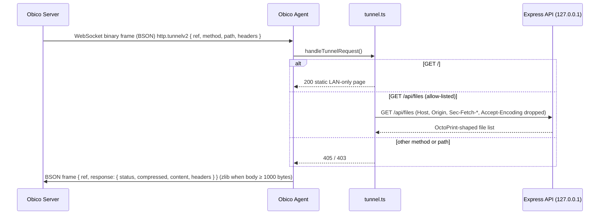
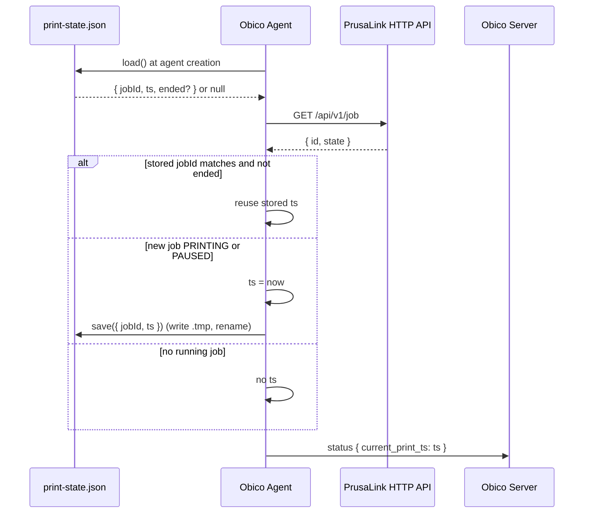

# Chapter 6: Runtime View

This chapter documents nine key runtime scenarios that illustrate how SentryBridge behaves during operation. Each scenario is shown as a Mermaid sequence diagram.

---

## Scenario 1: Pairing Flow

The initial pairing establishes the connection between SentryBridge and the Obico server. The wizard triggers this flow after the user configures PrusaLink and camera.

---

## Scenario 2: Frame Loop

After pairing, SentryBridge continuously captures camera frames and forwards them to Obico for AI failure detection. One persistent ffmpeg process decodes the RTSP stream; the bridge uploads at most one frame per `frameIntervalSeconds` and skips frames while an upload is still running. Uploads go through their own circuit breaker (`obico_frames`); when it opens, the `obico_frames` health component becomes DEGRADED and the WebSocket is not affected.

---

## Scenario 3: Reconnect Flow

When the Obico WebSocket connection drops, SentryBridge reconnects with exponential backoff.

---

## Scenario 4: Print-Start Flow

Obico sends a print command (from the Obico control panel or file library). SentryBridge dispatches it to PrusaLink and sends a ref-matched ACK.

---

## Scenario 5: Config Hot-Reload

When the user saves a new configuration through the dashboard, the bridge tears down all active connections and reinitialises with the new config.

---

## Scenario 6: Circuit Breaker Trip

When PrusaLink becomes unreachable, the circuit breaker opens after 5 consecutive failures, preventing further requests until the reset timeout expires.

---

## Scenario 7: Boot Checks

At bridge start (and on `POST /api/boot-checks`) the boot checks run in the background; the bridge never waits for them (ADR-0016).

---

## Scenario 8: Obico Tunnel Request

Obico's "OctoPrint" button and file dialog reach the bridge through `http.tunnelv2` (ADR-0010).

---

## Scenario 9: Print State Restore after Restart

The start timestamp sent to Obico as `current_print_ts` identifies a print. It is persisted in `print-state.json` so a bridge restart during a print does not split the print in Obico (ADR-0015).

