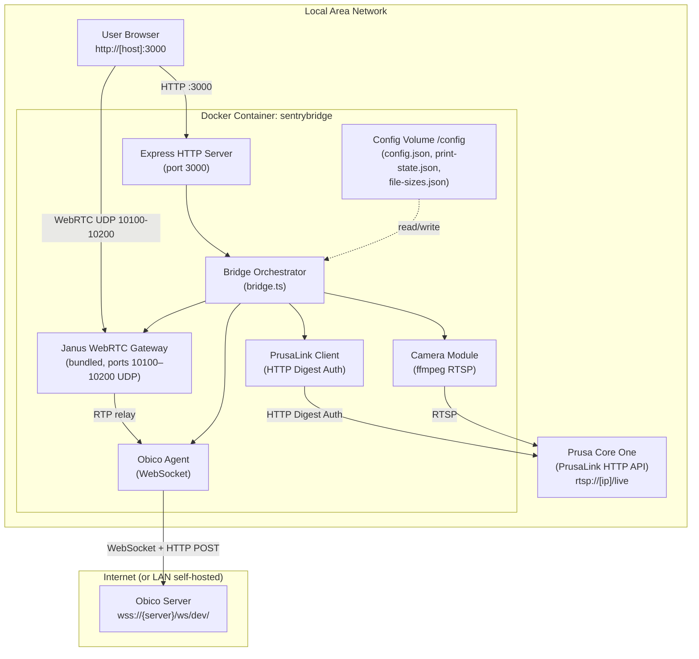

# 7. Deployment View

## Infrastructure

SentryBridge runs as a **single Docker container** on the user's LAN. One container instance manages exactly one Prusa printer.

## Deployment Configuration

| Concern            | Configuration                                                                                                                                                                                             |
| ------------------ | --------------------------------------------------------------------------------------------------------------------------------------------------------------------------------------------------------- |
| Container port     | `3000` (HTTP, `PORT`, default `3000`)                                                                                                                                                                     |
| WebRTC ports       | `10100–10200/udp` (Janus ICE media, `JANUS_RTP_PORT_RANGE`, default `10100-10200`)                                                                                                                        |
| Port binding       | `docker-compose.yml` publishes both port mappings on `JANUS_HOST_IP` only, not on all interfaces; Compose refuses to start when `JANUS_HOST_IP` is unset                                                  |
| Config persistence | Docker volume mounted at `/config` (`CONFIG_PATH`, default `/config/config.json`)                                                                                                                         |
| Persisted files    | `config.json` (mode `0600`), `print-state.json`, `file-sizes.json` (plus transient `.tmp` files during writes)                                                                                            |
| Runtime user       | Entrypoint starts as root, hands `/config` and the files above to `node` (uid 1000), then runs as `node` via `su-exec`; falls back to root with a warning if `/config` cannot be made writable (ADR-0012) |
| LAN IP for WebRTC  | `JANUS_HOST_IP` — advertised as ICE candidate; required for WebRTC and for the Compose port binding                                                                                                       |
| Janus mode         | `JANUS_MODE` (`bundled` \| `hosted` \| `auto`, default `auto` in code; Compose sets `bundled`)                                                                                                            |
| Janus log level    | `JANUS_DEBUG_LEVEL` (0–5, default `2`)                                                                                                                                                                    |
| Allowed hostnames  | `ALLOWED_HOSTS` (comma-separated, default empty). IP literals, single-label names (e.g. `localhost`) and `*.local` are always allowed (ADR-0013)                                                          |
| Resilience tuning  | `CIRCUIT_BREAKER_THRESHOLD` (`5`), `CIRCUIT_BREAKER_RESET_TIMEOUT_MS` (`60000`), `RETRY_BASE_DELAY_MS` (`1000`), `RETRY_MAX_DELAY_MS` (`30000`), `HEALTHCHECK_CRITICAL_TIMEOUT_MS` (`120000`)             |
| Restart policy     | `unless-stopped` recommended                                                                                                                                                                              |
| Grace period       | `stop_grace_period: 30s` (SIGTERM → ffmpeg shutdown)                                                                                                                                                      |
| Health check       | Dockerfile `HEALTHCHECK` probes `GET /api/health/live`; `docker-compose.yml` overrides it with `GET /api/health/ready`                                                                                    |
| Readiness check    | `GET /api/health/ready` — returns 503 when a critical component is DOWN for longer than `HEALTHCHECK_CRITICAL_TIMEOUT_MS` (default 120 s)                                                                 |

## Scaling

One container = one printer. To monitor multiple printers, run multiple container instances, each with its own config volume, its own host port (`PORT`, e.g. 3000, 3001, 3002) and a non-overlapping UDP range (`JANUS_RTP_PORT_RANGE`), because the Compose file publishes the same range on the host.

## Platform Support

Multi-platform Docker image: `linux/amd64` + `linux/arm64`. Tested on Unraid (AMD64) and Raspberry Pi 4 (ARM64).
